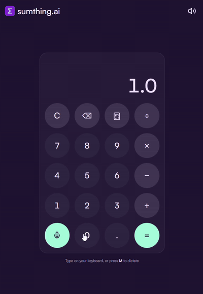

# [sumthing.ai](https://sumthing-ai.vercel.app) - **Your everyday AI calculator**



## Try it in one minute

Open **<https://sumthing-ai.vercel.app>** and tap:

| Type | You get | Note |
|---|---|---|
| `0.1 + 0.2 =` | `0.3` | Exact fractions. |
| `5 + 16 + 4 × 5 ÷ 15 =` | `22.3333333333` | `×` and `÷` come first (precedence) |
| `f(x)`, then `50 + 10 % =` | `55` | Tip: a Percent after `+` is a percent of the left side. |
| `1.05 ^ 12 =` | `1.795856326` | 12 months at 5%. |
| `85 ^ 8 =`, then swipe the Result | `2,724,905,250,390,625` | Long Results scroll. |
| `5 ÷ 0 =` | "Can't divide by zero." | Clear sentences. |

## How it works

```
React (Vercel)  ──POST /v1/calculate {"expression":"50+10%"}──▶  Go (Render)
                ◀──────────────── {"result":"55"} ────────────────
```

- The browser only builds the Expression. The server tokenizes it, checks it and calculates it with `math/big`. ([ADR 0001](docs/adr/0001-server-evaluates-the-whole-expression.md), [ADR 0002](docs/adr/0002-exact-fractions-with-big-rat.md))
- Power, square root and percent follow everyday limits, not scientific ones: an Exponent from 0 to 99, and Results with at most 100 digits. ([ADR 0004](docs/adr/0004-everyday-limits-for-the-optional-operations.md))
- One pure reducer holds every keypad rule, and components only render. The API client is passed in, so tests use a fake one. ([ADR 0003](docs/adr/0003-inject-the-calculator-client.md))
- Accessible: real buttons, visible focus, Results announced to screen readers, and reduced motion respected.

## API

`POST /v1/calculate` with `{"expression": "5+16+4*5/15"}` returns `{"expression": "5+16+4*5/15", "result": "22.3333333333"}`.

| Status | `code` | When |
|---|---|---|
| 400 | `INVALID_REQUEST` | the body is not JSON, or has no `expression` |
| 400 | `INVALID_EXPRESSION` | `5++3`, `abc`, `2^3^2` |
| 400 | `EXPRESSION_TOO_LONG` | more than 100 characters |
| 422 | `DIVISION_BY_ZERO` | `5/0` |
| 422 | `EXPONENT_OUT_OF_RANGE` | `2^0.5`, `2^100` |
| 422 | `RESULT_TOO_LARGE` | more than 100 digits before the point |

Errors look like `{"error": {"code": "DIVISION_BY_ZERO", "message": "Can't divide by zero."}}`. `GET /healthz` returns 200.

## Run it locally

```sh
docker compose up --build
```

Open <http://localhost:5173>. To develop the web app with hot reload instead:

```sh
docker compose up -d --build api
cd web && bun install && cp .env.example .env.local && bun run dev
```

| Variable | Where | Default |
|---|---|---|
| `PORT` | API | `8080` |
| `ALLOWED_ORIGIN` | API | `http://localhost:5173` |
| `VITE_API_URL` | web, at build time | required |

## Tests

```sh
cd api && go test -cover ./...   # calc 98.4%, httpapi 97.4%
cd web && bun run coverage       # 116 tests, 94.5% of statements
```
